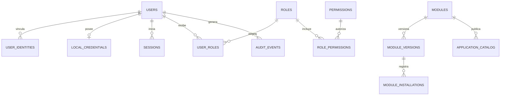

# Modelo de datos inicial

El esquema core contiene entidades normalizadas, unicidad issuer/subject binaria, sesiones indexadas y catálogo con FK al permiso requerido. Usuarios expiran o se deshabilitan; auditoría no se elimina por API.
Entidades adicionales previstas en fase 3: module_permissions, module_routes, module_dependencies, module_configurations y module_migrations. El JSON versionado del manifiesto conserva su definición mientras se implementa el motor.
Cada módulo futuro usará esquema y credenciales de acceso propios, separados del runtime del núcleo.
